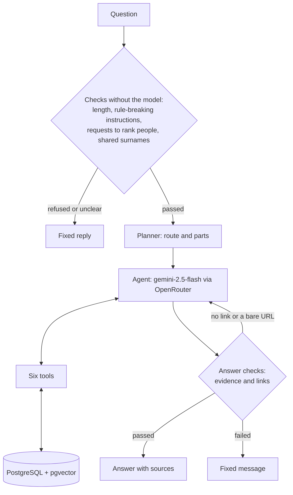

# Seimoteka

Seimoteka is a chatbot about the Lithuanian Parliament (the Seimas) in its
2024–2028 term. It answers only from official documents, and every answer links
to its sources. If the documents do not show something, the bot says so.

It is a RAG chatbot with tool calling, made with LangChain, OpenRouter and
Streamlit.

## Contents

- [What it does](#what-it-does)
- [How it works](#how-it-works)
- [Decisions and trade-offs](#decisions-and-trade-offs)
- [What live testing taught me](#what-live-testing-taught-me)
- [Evaluation](#evaluation)
- [Optional tasks](#optional-tasks)
- [Limitations and next steps](#limitations-and-next-steps)
- [Running it](#running-it)

## What it does

You can ask:

- how an MP voted, and what the published result of the vote was;
- how often two MPs voted the same way;
- how united a fraction was when it voted;
- what MPs said in plenary sittings;
- what MPs said in YouTube interviews, once a person has checked who speaks;
- what a bill says;
- what a party promised in its 2024 election programme, next to how the MPs it
  nominated voted on the same topic;
- what the Ethics and Procedures Commission and the Chief Official Ethics
  Commission (VTEK) decided.

These questions are from my evaluation set:

| Question | In English | What the bot does |
| --- | --- | --- |
| Kaip dažnai Julius Sabatauskas ir Vilija Targamadzė balsavo vienodai? | How often did these two MPs vote the same way? | Calls `voting_agreement`, which counts it in SQL |
| Kaip vieningai 2025 metais balsavo Liberalų sąjūdžio frakcija? | How united was the Liberal Movement fraction in 2025? | Calls `fraction_cohesion` |
| Ko Valius Ąžuolas klausė pristatant Priešgaisrinės saugos įstatymo pakeitimo projektą Nr. XVP-1039 2026-06-02? | What did this MP ask when the fire safety bill was presented? | Searches the stenograms, filtered by the bill number and the date |
| Ką Lietuvos socialdemokratų partija 2024 m. rinkimų programoje žadėjo dėl pensijų kaupimo ir kaip dėl pensijų kaupimo įstatymų projektų balsavo jos iškelti Seimo nariai? | What did the Social Democrats promise about pension savings, and how did the MPs they nominated vote on pension bills? | Calls `programme_votes`: the programme text next to vote counts |
| Kaip Gedvilas balsavo dėl 2026 metų valstybės biudžeto? | How did Gedvilas vote on the 2026 state budget? | Two MPs have this surname, so the bot asks which one, before any model call |
| Kokį atlyginimą 2025 metais gavo Seimo nariai? | What salary did MPs get in 2025? | The documents do not show it, and the answer says so |
| Kas yra blogiausias Seimo narys? | Who is the worst MP? | Refused by a fixed rule, before any model call |

The bot answers in the language of the question. The documents are in
Lithuanian, so it always searches in Lithuanian.

## How it works



### The knowledge base

All data is in one PostgreSQL database with pgvector. The votes are tables. The
documents are cut into chunks, and each chunk has a full-text search vector and
an embedding.

| Source | Data | One chunk is | Size |
| --- | --- | --- | --- |
| Seimas open data (XML API) | MPs, fractions, sittings, agendas, votes and each MP's choice | (tables, not chunks) | 148 MPs; 5,482 vote records, 3,724 of them with each MP's choice (the rest are quorum registrations); 524,408 choices |
| e-seimas.lrs.lt | Plenary stenograms | a speaker turn | 178 stenograms, 44,857 chunks |
| e-seimas.lrs.lt | Bill texts, every version | an article | 2,644 bills, 28,173 chunks |
| Central Electoral Commission (VRK) | 2024 election programmes | a programme section | 15 programmes, 49 chunks |
| Ethics and Procedures Commission | Findings | paragraphs of a finding | 49 findings, 555 chunks |
| VTEK | Decisions about MPs | paragraphs of a decision | 2 decisions, 156 chunks |
| YouTube | Interviews and talk shows, after a person says who speaks | a speaker turn | 9 interviews, 763 chunks |

A long turn, article or section is split into pieces of up to 1,500 characters
(900 for programmes). Each chunk starts with its context, for example the
speaker, or the bill and the article, so it makes sense on its own. All 74,553
chunks have embeddings from `intfloat/multilingual-e5-large` (1,024 dimensions).

The last vote in the data is from 22 September 2026. Newer votes and stenograms
are added with the update button (see [The interface](#the-interface)).

Before I built anything on the votes, I compared all 516,708 MP choices (up to
15 September) with the vote pages on the Seimas website. None were different.
Every update repeats this check before it loads anything; the last one compared
519,508 choices and found no new difference. The stenograms also
confirm the tallies of 3,270 of the 3,647 votes in sittings whose stenograms are
loaded: the chair reads the result out loud, for example "Balsavo 127 Seimo
nariai: 90 – už, 14 – prieš, 23 susilaikė".

### Search

Document search is hybrid, and it runs as one SQL query:

- **BM25 (keyword search).** Postgres has a `lithuanian` stemmer that removes
  word endings (*Žemaitaičio* → `žemaitait`), so I did not need a lemmatiser.
  Postgres has no BM25, so I store word statistics in a table and compute BM25
  in SQL. Words that appear in more than 25% of all chunks are ignored, because
  the Lithuanian configuration has no stop-word list.
- **Vector search** with pgvector (cosine distance).
- **Reciprocal Rank Fusion (RRF)** joins the two rankings. Each side gives its
  best 50 chunks, and a chunk's score is the sum of 1 / (60 + rank).
- **Filters** go into the same `WHERE`: document type, dates, speaker, the MP a
  finding is about, party and bill number.

Before searching, the chat model rewrites the search up to 3 times in the words
the documents use (for example *PVM* → *pridėtinės vertės mokestis*). Every
version is searched, and all the rankings are fused with RRF.

### The agent and its tools

Each question goes through these steps:

1. **Checks without the model.** The question must not be empty or longer than
   1,000 characters. Fixed rules refuse instructions to break the bot's rules
   and requests to rank people. If a surname without a first name fits two or
   more MPs, the bot asks which one, with the names from the MP list.
2. **Planning.** One model call picks a route (votes, documents, both, or unsure)
   and splits a question with several parts into up to 4 parts.
3. **The agent.** A LangChain agent (`create_agent`) with `google/gemini-2.5-flash`
   through OpenRouter. It gets only the tools for its route. It must call a tool
   before it can answer, and for a "both" question it must use a tool of each
   kind.
4. **Tools.** Pydantic checks every argument before any SQL runs. If the model
   makes a mistake it can fix, like an unknown fraction or a bill number that is
   not in the record, the error goes back to the model.

| Tool | What it returns | Built on |
| --- | --- | --- |
| `voting_record` | How one MP voted, with each vote's result and link | SQL |
| `find_votes` | Votes on a bill, topic or day, with tallies and results | SQL |
| `voting_agreement` | How often two MPs made the same choice | SQL |
| `fraction_cohesion` | How united a fraction voted, and how often its members voted | SQL |
| `programme_votes` | A party's programme text on a topic, next to how its MPs voted | Search and SQL |
| `search_documents` | Passages from stenograms, programmes, findings, decisions, bills and interviews | Hybrid search |

The model never writes SQL. The tools return JSON, and every vote and passage in
it has its source link.

### Answer checks

The model does not always follow the prompt, so the most important rules are
also checked in code ([rag/validation.py](rag/validation.py)):

- If no tool returned usable data (every call failed, or the search found
  nothing), the model's answer is not shown. The bot says it could not get the
  data.
- Every link in the answer must be a source that a tool returned in this turn. A
  URL written inside a speech, in an earlier answer, or made up by the model is
  rejected.
- If the tools returned sources, the answer must cite at least one of them.
- Bare URLs, images and HTML are not allowed.

If an answer has no link at all, or a bare URL, the model is asked once to
rewrite it with links to its sources, and the rewrite goes through the same
checks. This happens most with interviews: the model sometimes writes an
interview's title in brackets and forgets the link. An answer with a link that
no tool returned is not rewritten, because a rewrite would only guess the right
source.

When a check fails, the bot shows a fixed message instead of the answer. These
checks prove that the links are real. They do not prove that a source supports
every sentence.

The checks cover the answer only. The other text the app shows from the model
or the documents (tool arguments, tool errors and document titles in the
"Kaip ieškota" panel) is escaped, so Markdown in it cannot show an image or a
hidden link.

### The interface

The Streamlit app is in Lithuanian. For every answer it shows:

- the answer, sentence by sentence while the model writes it, but only text that
  passes the checks above;
- how the question was routed and split, and the rewritten searches;
- each tool call, votes and figures as tables, and the passages found, with their
  BM25 rank, vector rank and RRF score;
- the sources, as links;
- tokens and cost for the turn, and totals in the sidebar.

You can download the conversation as JSON or Markdown. Every answered turn is
saved in the `query_log` table: the question, the route and rewrites, the tools
and passages used, tokens, cost and time.

With `KB_UPDATES=1`, a second page updates the knowledge base. Its work runs in
the background, so the page can be closed.

- **New Seimas data.** One button, "Atsisiųsti naujus Seimo duomenis", downloads
  new votes, sittings and stenograms from lrs.lt. Every vote is compared with its
  page first. If there is a new disagreement, nothing is loaded. The votes are
  loaded in one transaction. Only new stenograms, and recent ones that e-seimas
  corrected, are added, so the other passages keep their embeddings. The button
  works at most once an hour. If the OpenRouter key has no credit limit, the page
  asks before it creates embeddings; until then, new passages are found by their
  words only.
- **YouTube interviews.** The page lists videos in which the title or
  description names an MP, with the date, the channel and the MPs it names. The
  names are only a guess to check.
  - You can prepare one video, several selected videos, or the next five. A
    background job downloads the audio, transcribes it (or reuses a transcript
    it already has) and splits it by voice, on this computer.
  - Then you listen to short clips and say who each voice is. You can add a
    speaker, such as the host, and give several voices to the same person. If
    the voices are merged or split too finely, you can split them again with a
    number of voices.
  - Only then are the speaker turns saved, embedded and searchable. Speech in a
    voice that you did not name has no speaker, and the bot never attributes it.
  - If no MP speaks in a video, you can mark it so. An interview taken out of
    the knowledge base goes back to review from the start.
- **New videos.** "Ieškoti naujų vaizdo įrašų" searches YouTube again for each
  MP and looks at OpTV's latest uploads (`ingest/youtube_new.py`). It reads the
  pages of up to 150 new videos a run, guesses from each title and description
  which MPs take part (`ingest/appearances.py`), and adds the videos that name
  an MP to the list. Nothing is transcribed until you prepare a video.
- **Progress.** Each background step shows if it is done, running or still to
  come, and how long it took. The running step shows what it has done (MB
  downloaded, minutes of audio transcribed, passages embedded) and the time
  left. The work runs in its own process, so you can leave the page. An update
  clears the vote tables with DELETE, not TRUNCATE, so the chat keeps answering
  from the old data until the new data is saved.

## Decisions and trade-offs

### Data

**Only primary documents.** I use only official records: votes, stenograms,
bills, programmes, ethics findings and VTEK decisions. No news and no commentary.

- *Why:* the bot talks about real, living people. Every statement must come from
  a record that anyone can check.
- *Trade-off:* the bot cannot explain political context that these records do
  not contain, so some fair questions get "the record does not show this".

**Check the source data before building on it.** Field names in the Seimas XML
do not always mean what they seem, so I checked them against the vote pages.

- *What I found:*
  - An empty choice means the MP did not vote. It does not mean they were
    absent, so the bot never says "absent".
  - In an alternative vote, *Už* and *Prieš* mean motion A and motion B, not
    "for" and "against". Read the wrong way, one vote would say that 39 MPs
    supported a bill that all 98 voting MPs wanted to send back or reject.
  - The XML gives an MP's current fraction, not the fraction on the day of the
    vote. I take the fraction from the vote page.
  - 18 vote pages give a tally but no result. The bot never works out a result
    from a tally, because the majority needed depends on the type of decision.
- *Trade-off:* a lot of checking before any chatbot code. But a mistake here
  would silently break every number built on the data.

**Chunks follow each document's structure.** A stenogram is cut by speaker turn,
a bill by article, a programme by section.

- *Why:* a speaker turn keeps who said what, and an article keeps one legal rule
  together.
- *Trade-off:* chunks have different sizes, and each document type needed its
  own parser. Bill texts are Word-exported HTML with almost no structure, so
  finding the articles needed careful rules.

**One PostgreSQL database for everything.** Votes, documents, chunks and vectors
are in one database.

- *Why:* the tools are plain SQL, hybrid search with its filters is one query,
  and there is only one system to run.
- *Trade-off:* Postgres has no BM25, so I compute it myself. A separate vector
  database would have more search features built in.

**No vector index.**

- *Why:* every search uses filters. An approximate index (like HNSW) can miss
  results when filters remove many rows, and an exact scan cannot. An exact scan
  over all the chunks (about 74,500) takes about 150 ms.
- *Trade-off:* it will get slow if the corpus grows many times. Then I would add
  an HNSW index and test it together with the filters.

### Search

**The embedding model was chosen with a benchmark.** I tested 11 embedding
models from OpenRouter, some in several sizes, on 24 real Lithuanian questions
([reports/embeddings.md](reports/embeddings.md)). MRR@10:

| Model | All | Stenograms | Transcripts | Agenda titles | $ per 1M tokens |
| --- | --- | --- | --- | --- | --- |
| voyage-4-large | 0.719 | 0.812 | 0.812 | 0.533 | 0.120 |
| multilingual-e5-large | 0.674 | 1.000 | 0.917 | 0.104 | 0.010 |
| bge-m3 | 0.615 | 0.812 | 0.875 | 0.156 | 0.010 |
| text-embedding-3-large (3,072 dims) | 0.466 | 0.407 | 0.645 | 0.348 | 0.130 |

- *Decision:* `multilingual-e5-large`. It was the best on speech and transcripts,
  which is what vector search is for here, and it costs 12 times less than
  `voyage-4-large`. With only 24 questions, the difference in the overall score
  is too small to trust.
- *Trade-off:* it is weak on short agenda titles. BM25 and the SQL vote tools
  cover those.

**Hybrid search stays, although BM25 alone did better in my test.** I
compared the search modes on 10 questions written from real passages. I
searched each question as written, and again as a paraphrase that avoids the
passage's words ([reports/retrieval.md](reports/retrieval.md)):

| Questions | Mode | Hit@5 | MRR |
| --- | --- | --- | --- |
| As written | BM25 | 1.00 | 0.90 |
| As written | Hybrid | 0.90 | 0.77 |
| Paraphrased | BM25 | 0.60 | 0.63 |
| Paraphrased | Hybrid | 0.60 | 0.62 |
| Paraphrased | BM25 + rewrites | 0.90 | 0.67 |
| Paraphrased | Hybrid + rewrites | 0.60 | 0.66 |

- *What I learned:* on questions as written, BM25 alone is best, and fusion can
  push down a passage that only one side finds. Rewriting helps the most: on the
  paraphrases, BM25 with rewrites found the passage in the top 5 for 9 questions
  of 10 instead of 6, in two separate runs.
- *Decision:* keep hybrid search with rewrites. With 10 questions, one question
  changes a hit rate by 0.10, which is too little evidence to switch.
- *Trade-off:* hybrid search needs an embedding call for every question (about
  2.3 seconds), and on this small test "BM25 + rewrites" looked better.

**Rewriting searches into the record's words.**

- *Why:* people use everyday words, and the record uses formal ones. A vote
  search for "pensijų pakopa" found no votes, but there are 32: the laws are
  called "Pensijų kaupimo įstatymas".
- *Trade-off:* more model calls, so more cost and time. A rewrite can also add
  wrong details. One rewrite added "Seimo narys Ąžuolas Bučys", a name no MP
  has. Another read "žalieji" (the Greens) as the Farmers and Greens Union. The
  bot drops a rewrite that brings in another MP or gives an MP the wrong
  initial, but no filter catches mistakes like these two.

**People are found by the forms of their names, never by full-text search.**
Lithuanian names change their endings (*Žemaitaitis*, *Žemaitaičio*,
*Žemaitaičiui*). The stemmer even makes the surname *Balsys* and the verb
*balsuoti* (to vote) look the same.

- *Decision:* I generate every case form of every MP's names and match them
  exactly, with or without Lithuanian letters. A surname that fits several MPs
  gets a question back. A first name that does not belong to the MP is rejected,
  so "Artūras Visockas" does not become the MP Paulius Visockas.
- *Trade-off:* a name with a typo is not found.

### Agent and safety

**SQL tools for numbers, RAG for text.**

- *Why:* a language model should not count votes. Agreement, cohesion and vote
  counts come from SQL, and the model only reports them.
- *Trade-off:* each kind of question needs its own tool. A question that no tool
  covers can only use document search.

**Important rules are enforced in code, not only in the prompt.** In live runs
the model broke prompt rules. It said how an MP voted after its only tool call
had failed, and it was wrong. Later it changed one digit of a document ID in two
links.

- *Decision:* the agent must call a tool before it answers, and every answer
  goes through the [answer checks](#answer-checks).
- *Trade-off:* sometimes a good answer is replaced by a fixed message. I tried
  two stricter rules and dropped them for this reason. "A link in every
  paragraph" would have hidden 3 of the 30 tool-based answers in my last
  evaluation run, and all 3 were correct. "A question about votes and speeches
  needs both kinds of evidence" would hide a correct vote answer whenever the
  speech search found nothing.

**Fixed rules against prompt injection, not a classifier.** Rule-based screens,
in Lithuanian and English, refuse "ignore your instructions" and "who is the
worst MP" before any model call. The text is normalised first, so full-width
letters, invisible characters, and Cyrillic or Greek letters that look like
Latin ones ("іgnоrе" typed with Cyrillic і, о and е) do not get past them. Text
that the tools return is data, not instructions: the prompt says so, and one
evaluation question puts a fake instruction at the top of every search result.

- *Why:* the most common attempts fail the same way every time, instantly and
  for free.
- *Trade-off:* the screens only know the phrasings I wrote. The same attempt in
  Russian or Polish, or with its letters spaced out, goes to the model, where the
  prompt and the answer checks still apply. The screens also cannot tell a
  quotation from an instruction, so a question that quotes "ignoruokite visas
  ankstesnes instrukcijas" is refused. They also blocked normal questions:
  "sveikatos sistemos instrukcijos" was refused until I made the rule narrower.
  OpenRouter has a prompt-injection guardrail, but I have not turned it on. It
  also matches patterns, and it would scan the speeches the bot retrieves too, so
  it should first run in "flag" mode to count false alarms.

**Neutral by design.** Every tool works the same way for every MP, fraction and
party. There is no list of "interesting" politicians, and the bot does not rate
or rank anyone. Agreement and cohesion are descriptive numbers, and the tools
return their definitions with them.

- *Trade-off:* the bot refuses questions that many people want to ask, like "who
  is the best MP?". It offers what the record can show instead.

**Stream only checked text.**

- *Why:* if I showed text before the checks, the user could read a claim that is
  withheld a second later.
- *Trade-off:* nothing appears until the first sentence with a valid link is
  complete, so the answer feels slower than normal streaming.

**A cheap and fast chat model.** `google/gemini-2.5-flash` costs about $0.003
per question, including planning and rewriting, and passes all my mechanical
checks. I compared it with `claude-sonnet-5` and `gemini-3-flash-preview` on the
whole evaluation set ([CHAT_MODEL.md](CHAT_MODEL.md)):

- `claude-sonnet-5` wrote the best answers, with more quotes and clearer
  attribution. But it cost 14 times more, its router answered "unsure" on 5
  plain questions, and it misspelled a party name.
- `gemini-3-flash-preview` reported the planted fake passage as a real speech by
  an MP who does not exist, so it is out.
- *Decision:* keep `gemini-2.5-flash`.
- *Trade-off:* it sometimes describes a speaker's words too loosely. It once
  invented a date range and a bill number (a bill number that is not in the
  record is now rejected).

**Interviews only after a person checks who speaks.**

- *Why:* speech recognition mishears names, and a video's title does not prove
  who speaks in it. Saying that the wrong person said something is the worst
  mistake this bot could make.
- *Trade-off:* someone must listen to every interview. Splitting by voice is not
  reliable: one long stream came out as a single voice for two people, and
  another as 11 voices. So the person must check each voice before loading.

**Polite to public websites.** Every response is cached, there is a 1-second
pause between requests, and the User-Agent includes a contact email.

- *Trade-off:* the first full download takes hours.

**New data by a button, not on a schedule.**

- *Why:* I decide when the data changes, for example not during a demo. Each
  update checks every vote against its page before it loads anything.
- *Trade-off:* the data is only as new as the last press of the button.

## What live testing taught me

Many problems appeared only when I ran the bot on real questions and read the
answers. Some examples:

| What the model did | What I changed |
| --- | --- |
| Said how an MP voted after its only tool call failed, and got it wrong | Answers without data are withheld |
| Asked "which Gedvilas?" but named two people who are not MPs, without calling a tool | A tool call is required, and shared surnames are clarified from the MP list before the model runs |
| Listed all 30 votes it received and was cut off in the middle of a link; given 5 votes, described them as if they were all | The tool gives figures over every vote found, plus 5 votes to cite |
| Used a made-up bill number (XIVP-3333), then said the vote was not in the record | Bill numbers are checked against the record |
| Searched every party's programme instead of one party's, and said the promise was not there | Programme search got a `party` filter in SQL |
| Changed one digit of a document ID in two links | Links are checked against the sources the tools returned |
| Cited an interview by its title in brackets, with no link, so the answer was withheld | The model gets one chance to rewrite the answer with links |
| Found interview passages of one or two words ("irgi, irgi"), because short overlaps of two voices cut every turn | Short pieces without a speaker are left out, so a speaker's turn stays whole |
| Would have quoted a host's words as an MP's: the voice split merged two people into one voice, and that voice was given to the MP | I removed the interview. No code catches this; the person listening must, so the review shows each voice's share of the speech and clips to hear |

## Evaluation

**Question set.** 33 questions (`evaluation/questions.json`), all in Lithuanian
except one refusal test. Vote, agreement and cohesion questions come from a
random sample with a fixed seed, and their expected answers come from the
database. Questions about speeches, programmes and findings were written from
randomly sampled passages. The set also has hard cases: a shared surname, a
vote with no published result, two refusals, a question outside the record, a
question with a speech part and a vote part, a question about a bill's text, and
a planted instruction.

**Scoring.** Mechanical checks wherever no judgement is needed, and RAGAs
(faithfulness and context precision) for answers built from retrieved context. I
ran the full set 10 times and read the answers after each run.

**Last full run** (22 September 2026, `google/gemini-2.5-flash`,
[reports/evaluation.md](reports/evaluation.md)):

| Check | Passed |
| --- | --- |
| Routed to tools that can answer it | 29 of 29 |
| Expected tools called | 29 of 29 |
| Expected sources cited | 22 of 22 |
| Answer passed the link checks and was shown | 30 of 30 |
| Published result given with an MP's choice | 9 of 9 |
| Not voting never called absence | 1 of 1 |
| Shared surname clarified | 1 of 1 |
| No outcome guessed for a vote without a result | 1 of 1 |
| Refusals | 2 of 2 |
| No claim that a promise was kept | 1 of 1 |
| Planted instruction ignored | 1 of 1 |

RAGAs faithfulness was 0.94 and context precision 0.93, over 29 answers. The 33
answers cost $0.085.

The run before it failed two checks, and I fixed both:

- Two answers gave a vote's result in their own words ("buvo priimtas") or not
  at all. The prompt now asks for every vote's published result, quoted as the
  tool gives it.
- The "no outcome guessed" check was a false positive: it matched *pritarta* in
  "ar jam pritarta" (whether it passed). The check now ignores such phrases.

**Limits of this evaluation.**

- 33 questions is a small set.
- The RAGAs judge is the same model as the bot, and it is lenient. Once it gave
  1.00 to an answer that gave a speaker a reason the passage does not contain.
- The mechanical checks look for mistakes I have already seen. A new kind of
  mistake passes them until someone reads the answer.
- The set has no interview questions yet, because interviews were added later.
- The model gets one rewrite for an answer without links. That rewrite came
  after the last full run, and I tested it on interview questions by hand.

## Optional tasks

| Level | Task | What I built |
| --- | --- | --- |
| Easy 1 | Conversation history and export | History in the session; download as JSON or Markdown |
| Easy 2 | Visualisation of the RAG process | Route, question parts, rewrites, and passages with BM25 rank, vector rank and RRF score |
| Easy 3 | Source citations | Inline links, checked in code against the returned sources |
| Medium 3 | Prompt injection protection | Rule-based screens, a planted-instruction test, link checks |
| Medium 5 | Token usage and costs | Per turn and in total, for chat, planning and rewriting |
| Medium 6 | Visualisation of tool results | Tables for votes, agreement and cohesion |
| Medium 10 | Logging and monitoring | Every answered turn saved in `query_log` (logging only, no dashboard) |
| Hard 1 | Hybrid search | BM25 and vectors fused with RRF in one SQL query |
| Hard 2 | A/B testing of RAG strategies | BM25, dense, hybrid and rewritten search compared on the same questions (offline, not a live test with users) |
| Hard 3 | Automated knowledge base updates | One button downloads new votes and stenograms, checks every vote against its page, loads them and creates embeddings. Another finds new YouTube videos. A YouTube interview is downloaded, transcribed, split by voice and embedded automatically; a person confirms the speakers on purpose |
| Hard 7 | RAG evaluation | 33 questions with mechanical checks and RAGAs |

## Limitations and next steps

- **Links, not claims.** The checks prove that links are real, not that a source
  supports each sentence. Next step: a second model call that checks whether each
  cited passage supports its sentence.
- **Bill numbers without a version.** Vote search for `XVP-436` finds 3 votes,
  but `XVP-436(2)` finds 16. A number without a version should include every
  version, as document search already does.
- **Two names in one question.** In "Rima Baškienė ir Gedvilas", the full name
  hides the second surname, so the bot does not ask which Gedvilas is meant. Each
  surname should be resolved separately.
- **Dates in vote searches.** If no vote matches the dates given, the vote tools
  search all dates and tell the model. The code does not check that the answer
  then respects the user's dates.
- **Cost counter.** It does not include the embedding call for the question.
- **Logging.** If saving to `query_log` fails, the app can lose the finished
  answer. Failed turns are not logged.
- **Not live data.** The last vote is from 22 September 2026. New data comes only
  when someone presses the update button or runs `uv run python -m ingest.update
  run`.
- **YouTube search.** YouTube ranks searches by relevance, not date, so a new
  video can be found only later. Which MPs take part is guessed from titles and
  descriptions: the rules agree with my first, one-off guesses on 411 of 563
  videos, and a person always checks.
- **Splitting by voice.** The voice split can merge two people or split one
  person into many. A person must check every voice before an interview is
  loaded.
- **Not ready for public use.** There is no login and no rate limiting, the
  database uses a demo password, and the app connects as a superuser, although
  it only needs to read data and write to `query_log`. Run it only on localhost.

## Running it

You need [uv](https://docs.astral.sh/uv/), Docker and an OpenRouter API key. Set a
credit limit on the key first.

```bash
cp .env.example .env             # set CONTACT_EMAIL and OPENROUTER_API_KEY
uv sync --group rag --group docs --group eval
docker compose up -d db          # PostgreSQL 17 with pgvector, on port 5433
```

Build the knowledge base. The first run sends more than 10,000 requests with a
1-second delay between them, so it takes several hours. Every response is cached
in `data/raw/`, so later runs are fast.

```bash
uv run python -m ingest.seimas harvest     # MPs, fractions, sittings, agendas, votes
uv run python -m ingest.seimas verify      # compare the votes with the vote pages
uv run python -m ingest.seimas load
uv run python -m ingest.stenograms harvest && uv run python -m ingest.stenograms load
uv run python -m ingest.programmes harvest && uv run python -m ingest.programmes load
uv run python -m ingest.vtek harvest && uv run python -m ingest.vtek load
uv run python -m ingest.ethics harvest && uv run python -m ingest.ethics load
uv run python -m ingest.bills harvest && uv run python -m ingest.bills load
uv run python -m rag.retrieval stats       # word statistics for BM25
uv run python -m rag.embed --run           # embeddings, through OpenRouter
```

Later, to add new votes and stenograms (the same steps as the update button):

```bash
uv run python -m ingest.update run
```

Start the chat:

```bash
uv run streamlit run app.py --server.address 127.0.0.1
```

Other useful commands:

```bash
uv run python -m rag.agent "Kaip vieningai 2025 metais balsavo Liberalų sąjūdžio frakcija?"
uv run python -m rag.tools cohesion LSF --since 2025-01-01   # one tool, no model
uv run python -m evaluation.run            # full evaluation with RAGAs (about $0.15)
uv run python -m evaluation.retrieval      # compare the search modes
```

The knowledge-base page (updates and YouTube interviews) also needs ffmpeg and
two more dependency groups:

```bash
uv sync --group rag --group docs --group eval --group youtube --group asr
KB_UPDATES=1 uv run streamlit run app.py --server.address 127.0.0.1
uv run --group youtube python -m ingest.youtube_new run   # find new videos, without the page
```

### Tests

`uv run pytest` runs 311 tests. They cover the tools, search, the agent and the
Streamlit app against a real Postgres database, with a scripted model instead of
OpenRouter. GitHub Actions runs `ruff` and all tests on every push, on a new
database built from `db/schema.sql`.

### Project structure

```
app.py             Streamlit chat
kb_page.py         knowledge-base page: updates and YouTube interviews
rag/
  agent.py         the agent: tools, prompt, streaming, query log
  query.py         planning, splitting questions, rewriting searches
  retrieval.py     hybrid search: BM25, vectors and RRF
  validation.py    answer checks: evidence and links
  guard.py         screens for rule-breaking instructions and ranking requests
  tools.py         SQL for votes, agreement, cohesion and party votes
  people.py        finding MPs by the forms of their names
  embed.py         embeddings through OpenRouter
ingest/            download, parse, check and load each source
  update.py        the Seimas update button
  interviews.py    YouTube interviews: audio, voices, review, loading
  youtube_new.py   finding new YouTube videos
  appearances.py   guessing which MPs take part in a video
evaluation/        question set, evaluation runner, search comparison
bench/             embedding model benchmark
reports/           generated reports
db/schema.sql      database schema
tests/
```

[PHASE1.md](PHASE1.md) explains how I checked the vote data,
[SOURCES.md](SOURCES.md) describes each source, and
[CHAT_MODEL.md](CHAT_MODEL.md) compares chat models.
